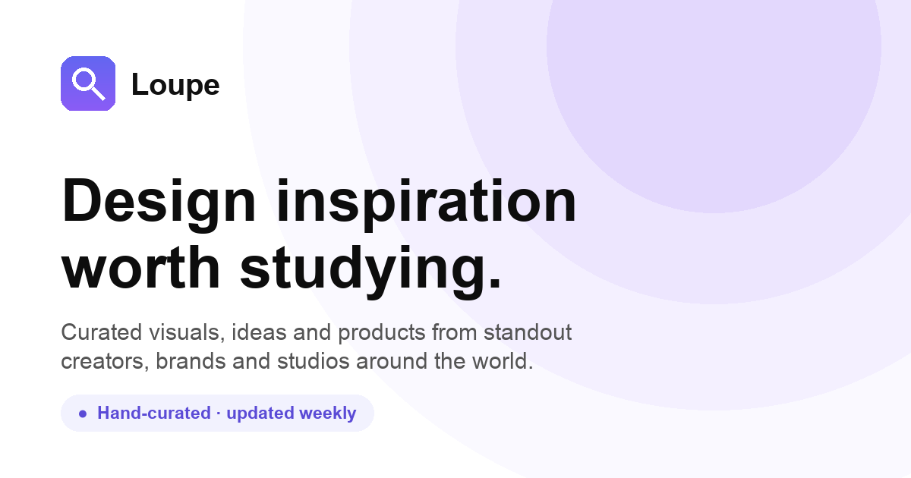
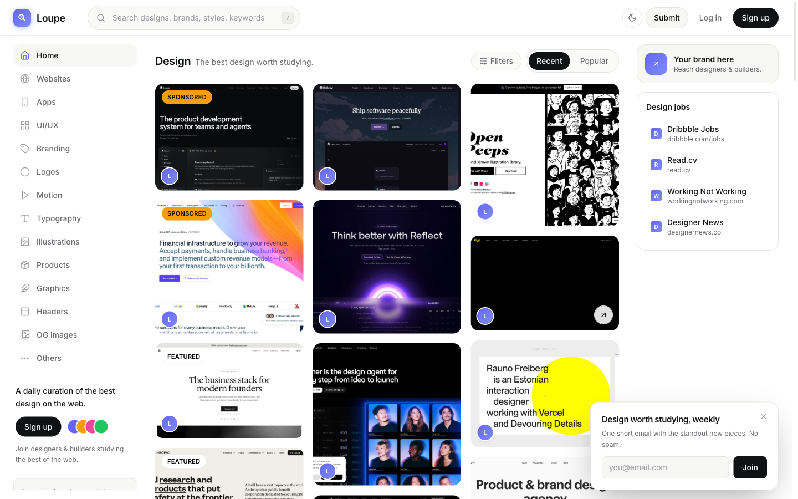
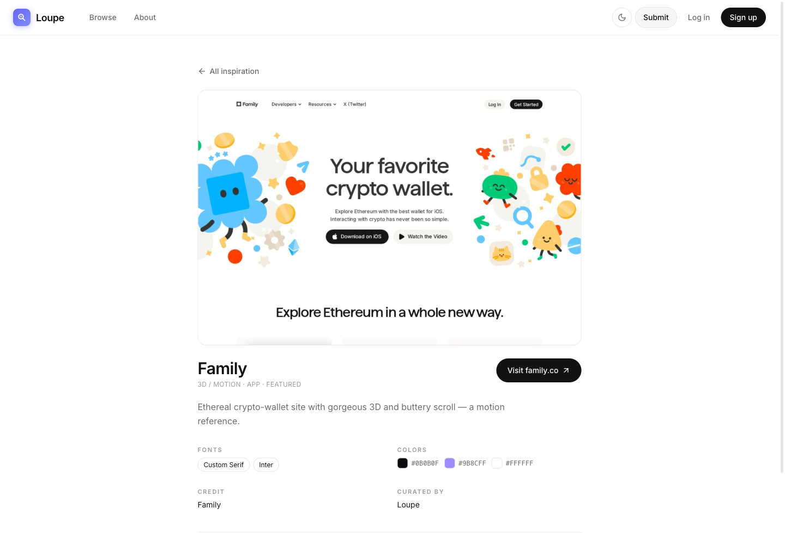
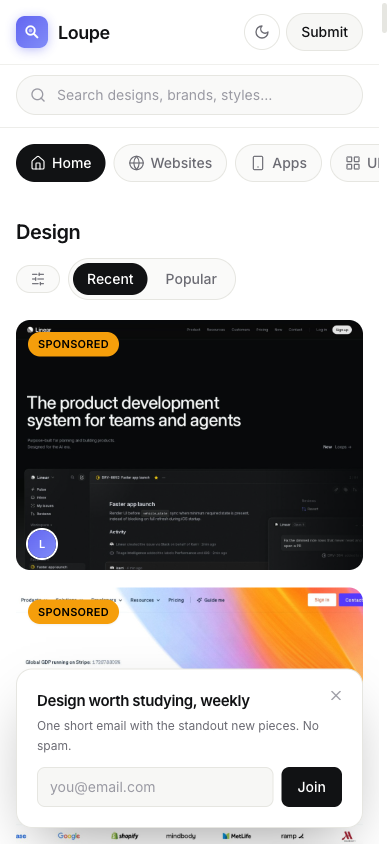

# Loupe

### Design inspiration worth studying.

A hand-curated gallery of the best design on the web — websites, apps, branding,
typography and visuals — where every piece is tagged with the details that actually
teach you something: its **fonts**, its **color palette**, its **style**, and
**credit** to the maker.

A *loupe* is the magnifier a designer uses to study fine detail. That is the whole idea.

 

&nbsp;

 

---

> **This is a public showcase.** It presents the product and the work. The full source
> code is kept **private** to protect the build. I am glad to walk a team or client through
> the codebase live on request.

## Why Loupe

Pinterest, Dribbble and the big galleries show you a pretty picture and stop there.
Loupe is built for people who want to **learn from** great design, not just scroll past it.
Every entry answers the questions a designer actually asks:

> What typeface is that? What is the exact palette? What style is this, and who made it?

The edge is not the code. It is **taste plus the metadata no one else bothers to capture.**

## Features

| | |
|---|---|
| 🖼️ **Curated gallery** | A clean, godly-style masonry of real screenshots. Pure image cards, no clutter. |
| 🎨 **Filter by color and font** | Find every piece that uses a specific color family or typeface. Nothing else does this. |
| 🏷️ **Rich metadata** | Each piece is tagged with fonts, a real color palette (click to copy), style, type and credit. |
| 🗂️ **14 categories** | Websites, Apps, UI/UX, Branding, Logos, Motion, Typography, Illustrations, Products and more. |
| ⚡ **Command palette** | `⌘K` to jump across pieces, categories and pages instantly. |
| 🌗 **Light and dark** | A premium light default and a full dark theme, remembered per visitor. |
| 🔗 **Shareable permalinks** | Every piece has its own page with a real social preview card. |
| 📨 **Weekly newsletter** | One short email with the standout pieces. Opt-in, no spam. |
| 🙋 **Submit and curate** | Anyone can submit a link; everything passes an editorial approval queue first. |
| 🔒 **Real auth** | Email plus Google / GitHub sign-in, per-user saved collections. |

## Screens

&nbsp;

Every piece opens into a study view: the full screenshot, the fonts, the palette as
copyable swatches, the credit, and a one-click visit to the source.

## How it is built

- **Framework** — Next.js (App Router, TypeScript), static export for edge-fast delivery
- **Styling** — Tailwind CSS, CSS-variable theming for light/dark
- **Data** — Supabase (Postgres + RLS + Auth), with a graceful fallback so the gallery never breaks
- **Delivery** — Cloudflare Workers, custom domain
- **Email** — Resend (transactional + a weekly newsletter on a cron)
- **SEO** — per-piece static pages, JSON-LD, sitemap and robots

Designed, built and shipped end to end by one person: UI, backend, auth, payments-ready
plumbing, SEO and the distribution plan.

## Source

The code is **private**. This repository is the public showcase. If you are evaluating me for
a role or a project, reach out and I will walk you through the real codebase and architecture.

## Author

Built, designed and run end to end by **Ksatria Bintang Samudra** (Bintang) — an AI-native
engineer shipping production-grade products solo, from the database to the pixels,
from Pontianak, Indonesia.

**Open to remote work and freelance.** If you want something like this built for your team, let's talk.

- Portfolio — [ksatriabintangsamudra.com](https://ksatriabintangsamudra.com)
- GitHub — [@Kstriabintang](https://github.com/Kstriabintang)
- Email — hello@ksatriabintangsamudra.com

## License

The showcase text and images in this repository are [MIT](LICENSE) © Ksatria Bintang Samudra.
The Loupe application source is private and not licensed for reuse.

Loupe — design inspiration worth studying.

